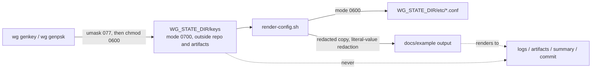

# Security and threat model

This document states what the project protects, how, what it explicitly does not
protect against, and where the residual risk sits. It describes the code in this
repository; it is not a generic WireGuard primer.

---

## 1. Assets

| Asset | Where it lives | Impact if disclosed |
|---|---|---|
| Server private key | `WG_STATE_DIR/keys/server.key`, mode `0600`, dir mode `0700` | Full impersonation of the server; an attacker can decrypt traffic to it |
| Client private key | Client device, and `WG_STATE_DIR/keys/client.key` during a harness run | Full impersonation of that client, including its tunnel IP |
| Preshared key (PSK) | `WG_STATE_DIR/keys/preshared.key` | Removes post-quantum resistance and weakens the handshake; a wrong PSK fails closed |
| Rendered configuration | `WG_STATE_DIR/etc/*.conf`, mode `0600` | Contains a private key, so treat as a credential |
| Public keys, tunnel addresses, endpoint | Configs, docs | Not secret; a leak is only an information-disclosure nuisance |

`WG_STATE_DIR` defaults to `/run/wg-harness` on purpose: a volatile, root-only path
that is **outside** both the repository and the artifact tree, so a `git add -A` or an
artifact upload cannot reach it. `/run` is cleared on reboot, which bounds the
lifetime of test keys even if cleanup is skipped.

## 2. Trust boundaries and the rules that enforce them

| # | Boundary | Rule | Enforced by |
|---|---|---|---|
| 1 | Untrusted input → runner | Workflows never interpolate `github.event.*` into shell; no `pull_request_target`; token is `contents: read` | `tests/check-workflows.sh` (10 assertions) |
| 2 | Runner root → secrets | Keys are created with `umask 077` in a `0700` directory and verified to be `0600` | `KEY-01..05`, `02-keygen.sh` |
| 2→3 | Root → publishable | Every log line passes `wg_scrub`; `wg show dump` output passes `wg_redact_dump` | `lib/common.sh`, `05-handshake.sh` |
| 3 | Publishable → committed | The working tree, artifact tree and job summary are scanned before the run ends | `10-leak-audit.sh` → `SEC-01..05` |
| 4 | Runner → internet | No listen sockets are ever exposed; the harness creates no inbound path | `docs/FEASIBILITY.md` §2.2 |

## 3. Key handling

Three deliberate decisions:

1. **Redaction is by literal value, not by key name.** `render-config.sh` blanks any
   variable whose *name* matches `PRIVATE|PSK|PRESHARED|SECRET|TOKEN|PASSWORD`,
   then additionally blanks any remaining `PrivateKey`/`PresharedKey` line. Name-based
   redaction alone would leak the moment a value appears under a different label —
   which is exactly what happened during development, when a `wg show` dump put the
   preshared key in a column that the name-based redactor did not cover.
2. **The scan is provenance-based first.** `secret_scan.py --secrets-from DIR` loads
   the key files the harness actually generated and searches every publishable file
   for those exact byte strings. This has no heuristic component: a private key
   cannot be "explained away" by a misleading label.
3. **The heuristic scan is deliberately paranoid.** A key-shaped token is treated as
   a secret unless the line it sits on *provably* names it public (`PublicKey =`,
   `public_key =`, `  public key:`, `peer: <key>`). An earlier version accepted the
   bare word "public" anywhere on the line, which would have let
   `# public key of the peer is <private key>` suppress a real finding.

## 4. Secrets in CI

* The harness **generates its own keys at run time** and stores nothing in the
  repository. There are no repository secrets, no environment secrets and no
  `secrets.*` references in either workflow — `SEC-04` asserts that no secret-bearing
  variable is exported into later steps.
* `actions/checkout` runs with `persist-credentials: false`, so the token is not left
  in `.git/config` for later steps to find.
* `permissions: contents: read` at workflow level and no job-level elevation; the
  harness never needs to write to the repository.
* Third-party Actions are pinned to commit SHAs, not tags. `SEC-05` fails the run if
  any `uses:` line is a floating ref.

| Action | Pinned SHA | Version | Provenance |
|---|---|---|---|
| `actions/checkout` | `11d5960a326750d5838078e36cf38b85af677262` | v4 | `verified: true` via the commit API |
| `actions/upload-artifact` | `ea165f8d65b6e75b540449e92b4886f43607fa02` | v4 | `verified: true` via the commit API |

Both target Node 20, so GitHub's runner forces them onto Node 24 and emits a
deprecation annotation on every run. That annotation is expected noise, not a
failure; it is recorded here so nobody has to rediscover it. Moving to the v5 SHAs
silences it at the cost of a fresh pin-and-verify cycle.

## 5. What the harness protects against

| Threat | Control | Check |
|---|---|---|
| Private key committed to the repository | Provenance + heuristic scan of the working tree | `SEC-01` |
| Private key uploaded as a build artifact | Same scan over `WG_ARTIFACT_DIR` | `SEC-02` |
| Private key echoed into the job summary | Same scan over `$GITHUB_STEP_SUMMARY` | `SEC-03` |
| Key leaking into the job log | `wg_scrub` on every log path, then `SEC-*` scan | `SEC-01..03` |
| Weak/default keys | Every key comes from `wg genkey`/`wg genpsk`; `KEY-05` asserts server and client keys differ | `KEY-01..05` |
| Config half-applied before validation | `validate_config.py` rejects unknown keys, overlapping `AllowedIPs`, an implausible MTU and placeholder values *before* `wg-quick` runs | `CFG-01..07` |
| Tunnel silently mis-routing traffic | `RT-*` assert the chosen source interface per destination, including a destination deliberately excluded from the tunnel | `RT-01..04` |
| A "connection" that is really just DNS-cache luck | `DNS-02` is a negative control: the same lookup must fail when the tunnel is down | `DNS-01..02` |
| Credentials accepted from a peer that should be rejected | `REC-01` proves a wrong PSK yields no handshake (fail-closed) | `REC-01` |
| Interrupted run leaving interfaces or keys behind | `EXIT` trap + `CLN-01..04` verify namespaces, routes, state dir and orphan processes | `CLN-01..04` |
| Unbounded retry loops | `wg_retry`/`wg_wait_for` take an attempt cap *and* a timeout; every loop is bounded | static analysis |
| Platform-enforcement evasion | The workflows run only the validation harness; no attempt is made to hold a listener open, keep a job alive artificially, or route third-party traffic | by design, see §6 |

## 6. What this project explicitly does **not** do

* It does not run a persistent VPN service. A GitHub-hosted runner cannot provide a
  stable inbound endpoint, and using Actions as one is outside the GitHub Terms for
  Additional Products and Features ([`FEASIBILITY.md`](FEASIBILITY.md) §2.4).
* It does not attempt to defeat, bypass or evade GitHub's rate limits, concurrency
  controls or job lifetime caps, and it does not try to keep a job alive to hold a
  connection open.
* It does not implement obfuscation, traffic shaping or censorship circumvention.
* It does not manage a firewall on your behalf. `wg_setup_nat` configures
  forwarding and NAT **inside a throwaway namespace** for the duration of a test and
  `09-cleanup.sh` removes each rule by exact match.

## 7. Residual risk

| Risk | Why it remains | Mitigation |
|---|---|---|
| A newly generated key could leak on the runner before cleanup | The key exists in plaintext in the VM's filesystem for the duration of the run | The VM is destroyed at the end of the job; keys are ephemeral by construction; the leak audit runs before the job ends |
| The scanner is a backstop, not a proof | Heuristics can miss an unforeseen encoding (hex, base64-of-base64) | Provenance mode covers the keys that actually matter; treat anything new that writes key material as needing an explicit scan rule |
| Pinned Actions can be revoked | Upstream supply chain | SHAs are pinned and their provenance verified; updating is a deliberate act |
| Public-repository Actions runs are visible to everyone | The repository is public | No secrets are ever placed in the workflows, so there is nothing to observe |
| A user copies a template and ships a placeholder as if it were real | Templates contain no `{{...}}` escape hatch | `validate_config.py` rejects placeholders unless `--allow-placeholders` is passed explicitly, and the deployment guide tells the reader how to tell the difference |

## 8. Reporting a problem

Open an issue with the failing check ID (for example `SEC-02`), the command that
reproduced it, and `artifacts/test-report.md` with keys redacted. Do **not** paste a
private key, a rendered configuration, or any `WG_STATE_DIR` file into an issue.
