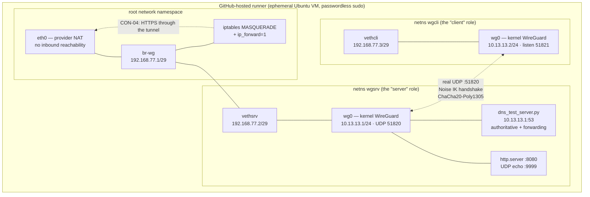
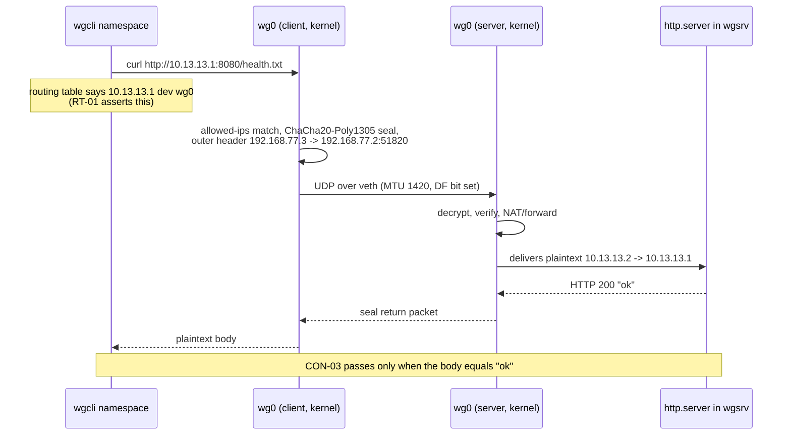
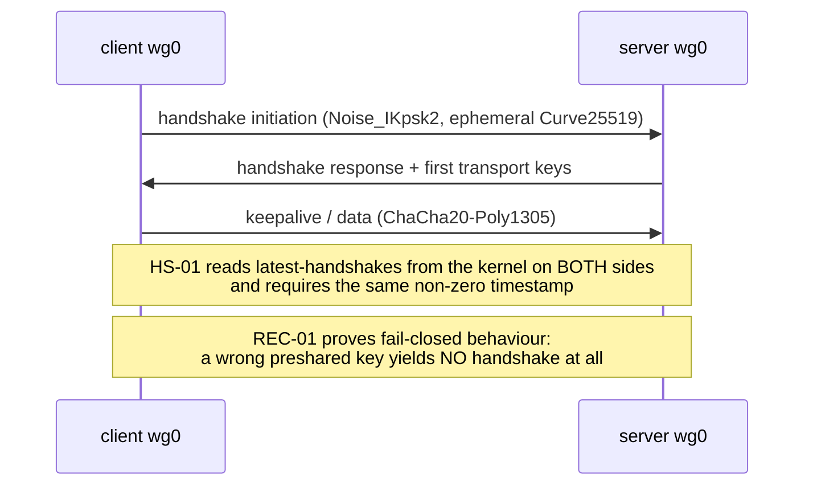
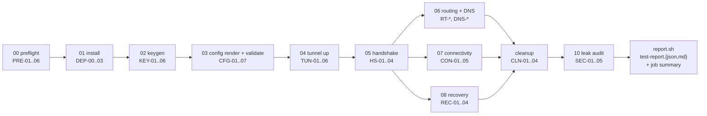
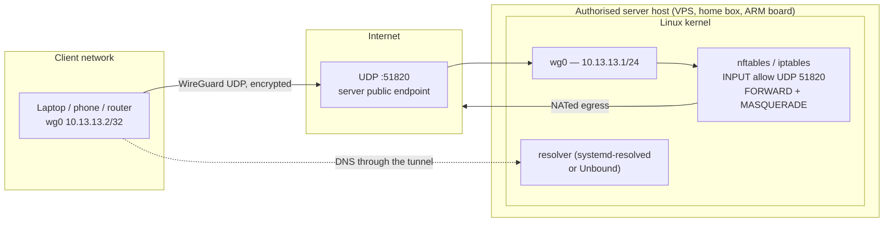
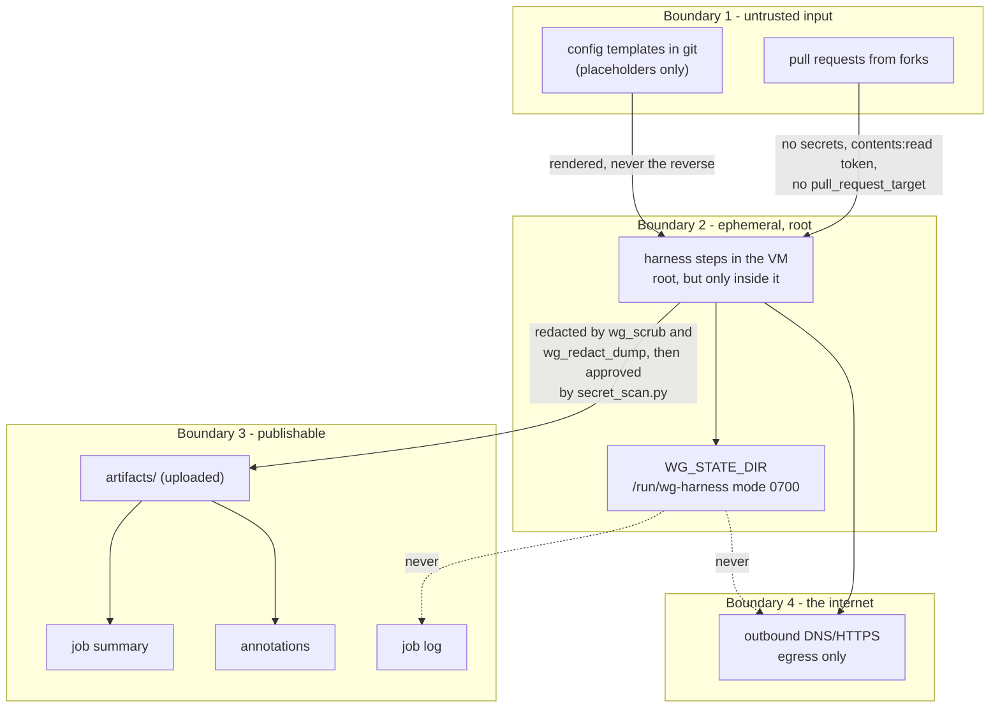
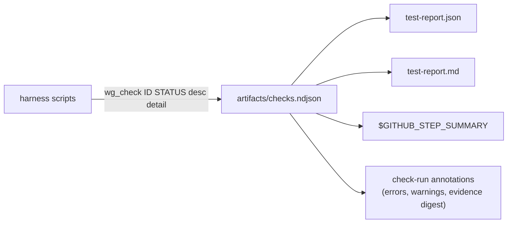

# Architecture

Two architectures live in this repository and they must not be confused:

1. **The validation harness** — what GitHub Actions runs on every commit. Hermetic,
   disposable, no inbound reachability, proves the data path works.
2. **The deployment kit** — what you run on a host you own. That is where a real
   WireGuard endpoint exists.

The harness exists because a hosted runner *cannot* be the second architecture.
[`FEASIBILITY.md`](FEASIBILITY.md) §2.2 proves that claim from GitHub's own
documentation and the runner's observed network behaviour.

---

## 1. Harness topology (one job, one runner, one kernel)

Everything below happens inside a single throwaway VM. The runner's real network is
touched only for DNS/HTTPS egress tests.

Why a `veth`/bridge between the namespaces instead of `127.0.0.1`? Because a
loopback peer would hide exactly the failures this harness exists to catch — MTU
miscalculation, `AllowedIPs` mistakes, source-address selection, and the routing
decision that decides whether a packet enters the tunnel at all. The veth gives the
two peers distinct addresses on a real link, so `RT-*` can assert *which* interface a
given destination is routed through.

Why put the "server" in its own namespace rather than on the root? So that the
harness can assert the client's traffic genuinely traverses `wg0` and the server's
NAT, and so cleanup is verifiable: if a namespace still exists, cleanup failed.

---

## 2. Data path of a single client request (`CON-03`)

The first packet on a fresh interface triggers the handshake, so the observable
provenance of a working tunnel is the handshake counter:

---

## 3. Harness control flow

`run-suite.sh` enforces three properties:

* **dependency order** — a step whose prerequisite failed is recorded `SKIP`, never
  run against a half-built testbed;
* **cleanup on every path** — an `EXIT` trap tears the testbed down even on `SIGTERM`
  or a failing step, and `SIGINT`/`SIGTERM` are trapped to log the interruption;
* **honest exit status** — the suite's exit code is derived from the recorded check
  rows, not from the last command that happened to run.

---

## 4. Deployment architecture (a host you own)

The endpoint must be reachable at a **stable** address for the client config to be
worth distributing, which is precisely what an ephemeral runner cannot provide — a
`PersistentKeepalive` setting only helps a client behind NAT, it does nothing for a
server whose address changes on every run.

---

## 5. Trust boundaries

The load-bearing rule is the dotted line: **key material never crosses from
boundary 2 to boundary 3.** It is enforced mechanically rather than by convention —
`wg_scrub` filters every log line, `wg_redact_dump` masks the private-key and
preshared-key columns of `wg show dump`, and `10-leak-audit.sh` then independently
scans the working tree, the artifact tree and the job summary with
`secret_scan.py --secrets-from`. See [`SECURITY.md`](SECURITY.md) for the failure
analysis.

---

## 6. Why the report is generated from NDJSON

`wg_check` appends one JSON object per check to `artifacts/checks.ndjson` as the run
proceeds. Reports are *derived* from that file rather than from the scripts
returning success:

* a step that dies halfway still leaves the checks it completed;
* the report can never claim more than was recorded;
* the same file feeds `test-report.json` (machine-readable), `test-report.md`
  (human), the job summary, and the annotation step.

